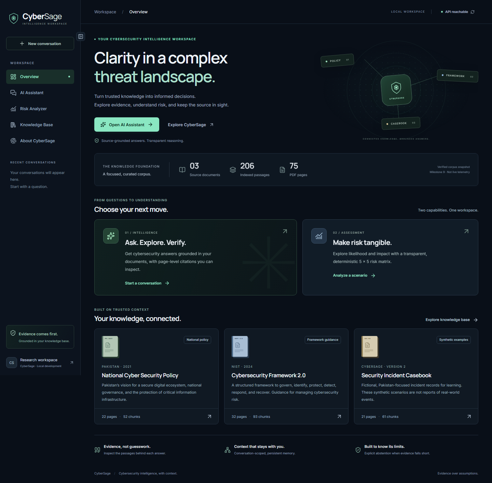
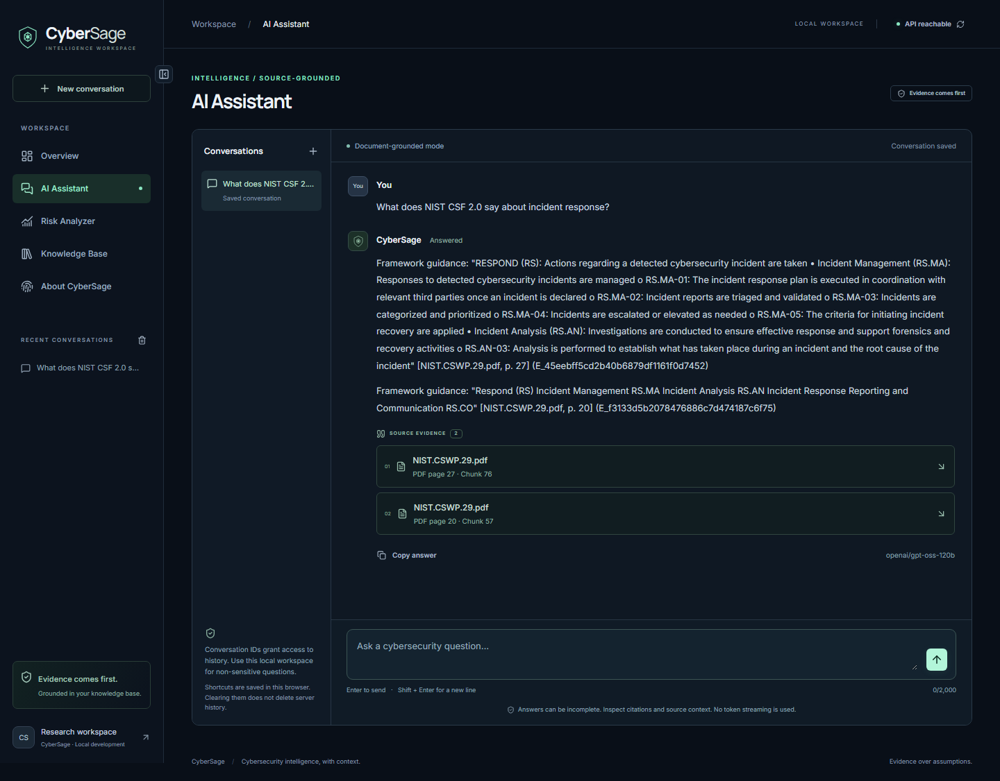
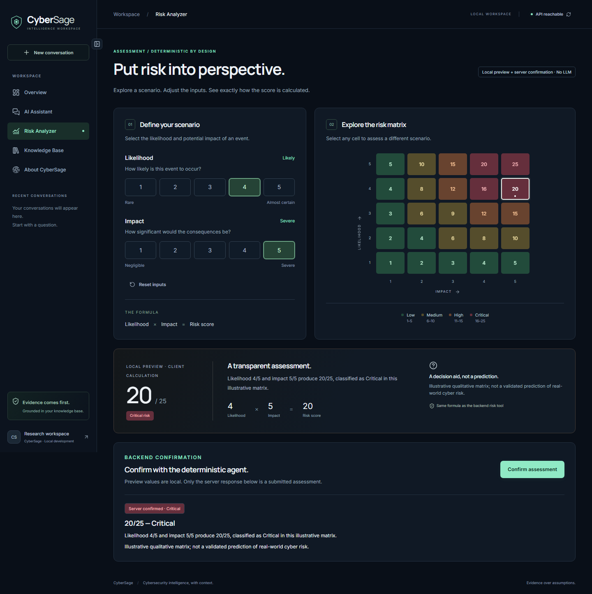
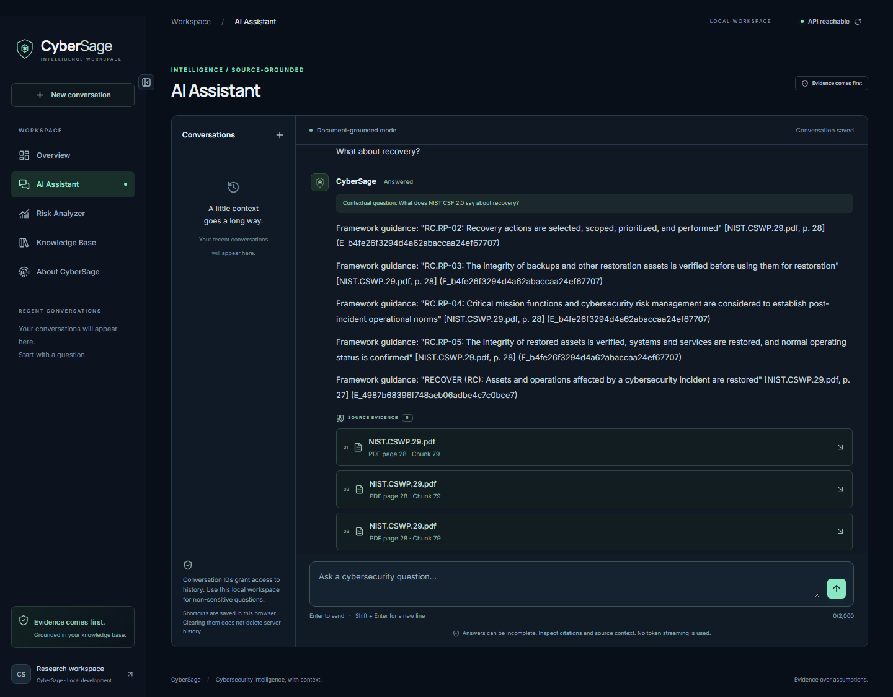
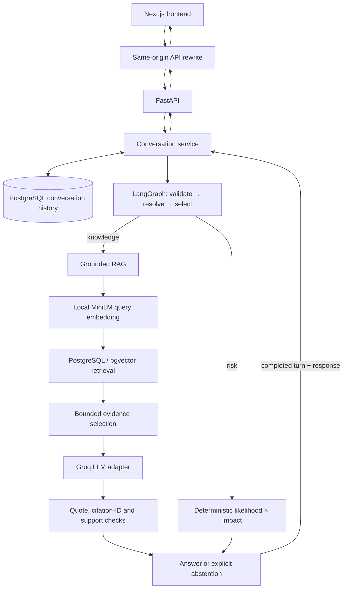

<div align="center">


<h1>CyberSage</h1>

<p><strong>Cybersecurity intelligence, with the source in sight.</strong></p>

<p>A full-stack, document-grounded AI assistant for exploring cybersecurity<br>policy, framework guidance, incident scenarios, and risk.</p>

<p>
  <a href="backend/requirements.txt"></a>
  <a href="frontend/package.json"></a>
  <a href="LICENSE"></a>
</p>

<p><a href="#getting-started">Run locally</a> · <a href="docs/demo-guide.md">Explore the demo guide</a> · <a href="docs/CyberSage_Final_Assignment_Report.md">Read the project report</a></p>

</div>

CyberSage brings **semantic retrieval, Groq inference, verified PDF citations,
LangGraph orchestration, deterministic risk scoring, and persistent memory** into
one Next.js workspace. Knowledge answers are assembled from checked source
excerpts, with document metadata and physical PDF pages attached. A bounded
agent selects either document-grounded answering or a numerical risk tool.

The system makes its evidence and limits visible: inspect a quote, follow a
conversation, confirm a calculation, or receive an explicit insufficient-evidence
response. Citation safeguards improve traceability; they do not guarantee factual
correctness or complete answers.

> **Project status:** Working local research application with recorded full-stack
> validation. Authentication and public-deployment hardening are not implemented.

## Contents

- [Features](#features)
- [Screenshots](#screenshots)
- [Technology stack](#technology-stack)
- [System architecture](#system-architecture)
- [Knowledge sources](#knowledge-sources)
- [Getting started](#getting-started)
- [Configuration](#configuration)
- [API reference](#api-reference)
- [Evaluation and testing](#evaluation-and-testing)
- [Project structure](#project-structure)
- [Security and limitations](#security-and-limitations)
- [Roadmap](#roadmap)
- [Documentation](#documentation)
- [License](#license)

## Features

| Capability | Implemented behavior |
|---|---|
| **Grounded AI assistant** | Cosine-based document retrieval, evidence selection, checked source excerpts and PDF page citations. Explicit abstention when evidence or validation is insufficient. Synthetic incidents remain labeled. |
| **Bounded LangGraph agent** | One acyclic workflow: validate, resolve context, route, execute RAG or risk scoring, format, terminate. Deterministic capability selection and an eight-step execution guard. |
| **Risk Analyzer** | Interactive 5×5 likelihood/impact matrix, local preview and separate backend-confirmed assessment. Low, Medium, High and Critical categories; no LLM arithmetic. |
| **Conversational memory** | PostgreSQL-persisted turns, source-scoped follow-up resolution, refresh/restoration, paged history and conversation isolation. Bounded context; no numerical carryover into risk requests. |
| **Source-aware knowledge base** | Three indexed PDFs covering Pakistan's cybersecurity policy, NIST guidance and fictional incident examples. Page-aware chunks preserve source references. |
| **Responsive frontend** | Navy/teal Next.js interface, desktop sidebar/mobile drawer, citation panels, recent conversation shortcuts, safe Markdown, keyboard focus states and reduced-motion support. |

The interface has five routes: `/`, `/assistant`, `/risk-analyzer`,
`/knowledge-base` and `/about`. There are no upload, deletion or PDF-download
controls, and no simulated token streaming or live threat telemetry.

## Screenshots

Existing captures from the real-service integration run; no generated example
answers or recreated screenshots. Dashboard counts are a labeled corpus snapshot.



<details>
<summary><strong>Explore the assistant, risk assessment, and conversational memory</strong></summary>

### AI Assistant — real NIST answer and citations



### Risk Analyzer — server-confirmed 20 / Critical



### Memory — a recovery follow-up resolved to NIST



</details>

[Screenshot provenance and hashes](docs/submission-evidence/README.md) ·
[Recorded live responses](docs/milestone11-live-results.json)

## Technology stack

| Layer | Packages / verified versions | Role |
|---|---|---|
| Frontend | Next.js **16.4.6**, React **19.3.1**, TypeScript **6.0.3** | App Router, strict types and reusable feature workspaces |
| Design system | Tailwind **4.3.5**, shadcn/ui component patterns with Radix **1.8.1**, Motion **14.14.0**, Lucide React **1.72.0** | Accessible primitives, interaction and visual identity |
| API | Python **3.12**, FastAPI **0.162.2**, Pydantic settings | Input/output validation and service composition |
| Agent / generation | LangGraph **1.2.21**, official Groq SDK **1.7.0** | Bounded routing and replaceable LLM provider adapter |
| AI / retrieval | Sentence Transformers **6.3.0**, `all-MiniLM-L6-v2`, pgvector **0.8.7** | Normalized 384-dimensional embeddings and grounded RAG |
| Database access | PostgreSQL **17** (validated **17.11**), SQLAlchemy **2.1.8**, psycopg **3.3.8** | Source vectors, metadata and transactional conversation persistence |
| Infrastructure | Docker Compose, `pgvector/pgvector:pg17` | Loopback-bound PostgreSQL and persistent database volume |
| Tests | pytest **9.2.0**, Vitest **5.1.0**, Testing Library, Playwright **1.65.0**, axe | Backend, component, browser and accessibility checks |

Frontend versions are pinned in [package.json](frontend/package.json) and
[package-lock.json](frontend/package-lock.json). Backend versions above describe
the inspected local environment; [requirements.txt](backend/requirements.txt)
uses a mixture of version ranges and unpinned dependencies, not a complete lock.
The configured Groq text model is **`openai/gpt-oss-120b`**, subject to account
availability. No GPU is required for the local MiniLM embedding workflow.

## System architecture



Storage/response arrows represent data flow, not agent execution loops. The graph
itself is acyclic. Prior user context resolves a follow-up **before fresh
retrieval**; prior assistant prose is not source evidence. Risk inputs come from
the current request.

Ingestion is an explicit CLI operation: file hash → page extraction → page-aware
chunks → batch embeddings → transactional storage. Repeated ingestion skips
already indexed files. Retrieval uses parameterized SQLAlchemy cosine queries
with deterministic tie ordering. Similarity is **1 − cosine distance**, not a
probability of correctness.

Citation metadata comes from the database. The model selects evidence IDs and
excerpts; local quote/ID checks and a constrained provider support/relevance
verdict determine whether an answer can be returned.
[Detailed architecture and trust boundaries →](docs/architecture.md)

## Knowledge sources

**Reference corpus: 3 indexed documents · 75 PDF pages · 206 stored chunks.**

| Document | Pages / chunks | Why it is included |
|---|---:|---|
| Pakistan National Cyber Security Policy 2021 | 22 / 52 | Pakistan-focused governance, national priorities and critical infrastructure protection |
| NIST Cybersecurity Framework 2.0 | 32 / 93 | Structured cybersecurity outcomes, including incident response and recovery |
| CyberSage Security Incident Casebook v2 — **synthetic** | 21 / 61 | Controlled fictional scenarios for exploring detection, containment, recovery and illustrative assessments |

Chunks retain **physical PDF page numbers**, which may differ from printed body
page labels. The casebook is not evidence of real incidents. Counts describe the
verified reference corpus, not a live inventory endpoint or arbitrary replacement
documents.

Source PDFs are excluded from Git. Obtain authorized copies separately before
indexing; the repository alone does not reproduce the reference corpus. Use
these filenames under `data/raw/`:

```text
2021-National-Cyber-Security-Policy-Final.pdf
NIST.CSWP.29.pdf
CyberSage_Security_Incident_Casebook_RAG_v2.pdf
```

The [evaluation artifact](backend/evaluation/results/milestone9.json) records
source hashes and page counts. No source PDFs are redistributed here.

## Getting started

### Prerequisites

Install [Git](https://git-scm.com/downloads/),
[Python 3.12](https://www.python.org/downloads/),
[Node.js 24 LTS with npm](https://nodejs.org/en/download), and
[Docker with Compose](https://docs.docker.com/get-started/get-docker/).
The reference environment used Python 3.12.10, Node 24.20.0 and npm 11.19.0.
Docker must be running. The first embedding load needs network access to download
the model; inference can subsequently use the local cache.

A [Groq account/API key](https://console.groq.com/docs/quickstart) is required for
grounded answer generation. Retrieval and local embedding generation do not need
a Groq key. The agent API, including risk assessment, requires PostgreSQL for
conversation persistence.

Commands below use **Windows PowerShell**, without activating the virtual
environment or changing execution policy. `python --version` must identify
Python 3.12. `npm.cmd` avoids PowerShell's blocked `npm.ps1` on some systems.
On macOS/Linux, use `python3.12`, `.venv/bin/python`, `npm`, and equivalent shell
file-copy commands.

### 1. Clone and configure

```powershell
git clone https://github.com/syedamahnoor-sm/cybersage.git
cd cybersage
Copy-Item .env.example .env
```

For a fresh clone, edit root `.env`: set a nonempty `POSTGRES_PASSWORD` and your
`GROQ_API_KEY`; keep the database user/name consistent with Compose. Do not paste
credentials into chat or commit them. **Keep existing environment files when
continuing an installed workspace.**

The root `.env` is sufficient for database credentials and the Groq key.
`backend/.env` is optional and overrides root values, including empty ones;
avoid copying a blank backend template over working root credentials.

### 2. Start PostgreSQL and initialize a new database

From the repository root:

```powershell
docker compose up -d db
docker compose ps
```

Wait for `db` to become healthy. For a **new database only**, apply both explicit
SQL migrations in order:

```powershell
Get-Content -Raw backend/migrations/001_initial_schema.sql | docker compose exec -T db sh -c 'psql -v ON_ERROR_STOP=1 -U "$POSTGRES_USER" -d "$POSTGRES_DB"'
Get-Content -Raw backend/migrations/002_conversational_memory.sql | docker compose exec -T db sh -c 'psql -v ON_ERROR_STOP=1 -U "$POSTGRES_USER" -d "$POSTGRES_DB"'
```

Migration 001 creates source/vector tables; 002 creates conversation tables.
**Do not rerun 002 on an initialized database.** There is no automatic migration
runner or migration ledger. Existing workspaces should verify their schema
instead of resetting volumes or replaying migrations. Compose exposes PostgreSQL
at `127.0.0.1:5433` and persists data in its named volume.

### 3. Install the backend and provide the PDFs

Still at the repository root:

```powershell
python --version
python -m venv backend/.venv
.\backend\.venv\Scripts\python.exe -m pip install -r backend/requirements.txt
New-Item -ItemType Directory -Path data/raw -Force | Out-Null
```

Place the three authorized PDFs listed above in `data/raw/`. Do not recreate an
existing virtual environment unless you intend to replace it.

### 4. Verify and index

```powershell
cd backend
$env:HF_HOME = Join-Path (Get-Location) '.cache\huggingface'
.\.venv\Scripts\python.exe -m app.ingestion --check-db
.\.venv\Scripts\python.exe -m app.ingestion --batch-size 32
.\.venv\Scripts\python.exe -m app.ingestion --verify
```

Ingestion prints processed/skipped documents, inserted chunks and failures.
With the reference PDFs/current chunker, the corpus is 3 documents and 206 chunks.
For an existing indexed workspace, use `--check-db` and `--verify` without
reingestion. `--input-dir` supports a different source directory.

### 5. Start FastAPI

In the backend terminal:

```powershell
.\.venv\Scripts\python.exe -m uvicorn app.main:app --host 127.0.0.1 --port 8000
```

For a new backend terminal, enter `backend/` and set `HF_HOME` as above to reuse
the same model cache. Interactive API documentation is at
`http://127.0.0.1:8000/docs`; health is `http://127.0.0.1:8000/api/v1/health`.
Health checks FastAPI reachability, not database/model/provider readiness.

### 6. Start Next.js

In a **second terminal**, from the repository root:

```powershell
cd frontend
npm.cmd ci
if (!(Test-Path .env.local)) { Copy-Item .env.example .env.local }
npm.cmd run dev -- --hostname 127.0.0.1 --port 3000
```

Open **`http://127.0.0.1:3000`**. The frontend defaults to FastAPI on port 8000.
If a port is occupied, choose another local port; update `FASTAPI_BASE_URL` when
the API port changes and restart Next.js. Production mode uses `npm.cmd run build`
then `npm.cmd run start -- --hostname 127.0.0.1 --port 3000`.

## Configuration

Source templates: [root](.env.example) · [backend](backend/.env.example) ·
[frontend](frontend/.env.example). Settings precedence is **process environment →
backend `.env` → root `.env` → application defaults**.

| Setting | Default / expected value | Purpose |
|---|---|---|
| `APP_NAME`, `APP_ENV`, `DEBUG` | `CyberSage`, `development`, `false` | API identity and local application settings |
| `POSTGRES_USER`, `POSTGRES_PASSWORD`, `POSTGRES_DB` | Set locally; password intentionally blank in examples | Shared backend/Compose credentials |
| `POSTGRES_HOST`, `POSTGRES_PORT` | `127.0.0.1`, `5433` | Backend connection to the Compose database |
| `GROQ_API_KEY` | Set locally on the backend | Required for generation; never a frontend variable |
| `GROQ_MODEL` | `openai/gpt-oss-120b` | Account-supported text model, validated through the provider |
| `GROQ_TEMPERATURE` | `0` | Evidence-grounded generation setting |
| `GROQ_TIMEOUT_SECONDS`, `GROQ_MAX_OUTPUT_TOKENS` | `30`, `2048` | Provider request/output bounds |
| `RETRIEVAL_MIN_SIMILARITY` | `0.2` | Permissive cosine cutoff, not calibrated confidence |
| `RAG_MAX_RETRIEVED_CHUNKS` | `8` | Maximum evidence candidates allowed by RAG |
| `RAG_MAX_CONTEXT_CHARS`, `RAG_MAX_PROMPT_CHARS` | `8000`, `24000` | Evidence and prompt budgets |
| `MEMORY_HISTORY_TURNS`, `MEMORY_HISTORY_CHARS` | `6`, `8000` | Bounded recent conversational context |
| `HF_HOME` | Library default unless explicitly set | Hugging Face model-cache directory; optional runtime environment setting |
| `HF_HUB_OFFLINE` | Unset | Set to `1` only after the model is cached |
| `FASTAPI_BASE_URL` | `http://127.0.0.1:8000` | Server-side Next.js rewrite target |
| `NEXT_PUBLIC_API_BASE_URL` | Unset | Optional direct-browser API base; requires explicit backend CORS setup |

The embedding model and dimension are constants in
[the embedding service](backend/app/embeddings/service.py), not configurable
`EMBEDDING_*` environment variables. They must remain compatible with `VECTOR(384)`.

The default same-origin rewrite requires no backend CORS change. Never expose
Groq/database secrets through `NEXT_PUBLIC_*`. Restart Next.js after changing
its target; rebuild when using a production server. The rewrite timeout is
125 seconds and the client abort is 120 seconds; provider timeouts remain bounded.

## API reference

Base URL: `http://127.0.0.1:8000`. FastAPI's `/docs` and `/openapi.json` provide
the complete runtime schemas.

| Method | Endpoint | Request / query | Response |
|---|---|---|---|
| `GET` | `/api/v1/health` | None | `status`, `service`, `version` |
| `POST` | `/api/v1/retrieval/search` | `query`, optional `top_k`, `min_similarity` | `query`, `results`, `result_count`, `min_similarity` |
| `POST` | `/api/v1/rag/ask` | `question`, optional `top_k` | Answer/status/citations, evidence counts, model, grounding mode and abstention reason |
| `POST` | `/api/v1/agent/invoke` | `message`; optional ratings, `top_k`, conversation/request IDs | Selected capability, answer or assessment, status, citations and conversation metadata |
| `GET` | `/api/v1/conversations/{conversation_id}/messages` | Optional `limit` and `before_turn` | `conversation_id`, `messages`, `has_more`, `next_before_turn` |

Questions are trimmed, nonblank strings up to **2,000 characters**. `top_k`
defaults to 5 and accepts integers 1–20; the RAG service also enforces its own
retrieved-chunk cap. Risk ratings must be actual integers 1–5, not strings,
booleans or decimals. History `limit` defaults to 10 and accepts 1–20 **turns**,
each containing user/assistant messages; `before_turn` is an exclusive cursor.
There is no endpoint that lists all conversations.

### Ask and continue a conversation

```powershell
$base = 'http://127.0.0.1:8000'
$body = @{
    message = 'What does NIST CSF 2.0 say about incident response?'
    top_k = 5
    request_id = [guid]::NewGuid().ToString()
} | ConvertTo-Json
$reply = Invoke-RestMethod -Method Post -Uri "$base/api/v1/agent/invoke" -ContentType application/json -Body $body
$reply | Select-Object capability, status, answer, citations, conversation_id
```

After allowing for provider rate limits, reuse the returned conversation ID:

```powershell
$followup = @{
    message = 'What about recovery?'
    conversation_id = $reply.conversation_id
    request_id = [guid]::NewGuid().ToString()
} | ConvertTo-Json
Invoke-RestMethod -Method Post -Uri "$base/api/v1/agent/invoke" -ContentType application/json -Body $followup
Invoke-RestMethod -Uri "$base/api/v1/conversations/$($reply.conversation_id)/messages?limit=10"
```

Agent responses include `capability`, `status`, nullable `answer`, `assessment`,
`error` and `model`, `citations`, `retrieved_evidence_count`,
`selected_evidence_count`, `abstention_reason`, `conversation_id`, `request_id`,
`resolved_message` and `context_used`. Preserve the original request body and ID
when retrying a failed request; generate a new ID for a new turn.

Statuses are `answered`, `assessed`, `insufficient_evidence`, `missing_input`,
`needs_clarification`, `invalid_input` and `error`. Missing or ambiguous inputs
can return a structured HTTP 200 clarification response; inspect `status` and
`error` rather than assuming every HTTP 200 contains an answer.

### Submit a risk assessment

```json
{ "message": "Calculate risk", "likelihood": 4, "impact": 5 }
```

Recorded response excerpt from the real agent run; unrelated fields are omitted:

```json
{
  "capability": "risk",
  "status": "assessed",
  "assessment": { "likelihood": 4, "impact": 5, "score": 20, "category": "Critical" },
  "citations": [],
  "model": null
}
```

**Score = likelihood × impact.** Low: 1–5; Medium: 6–10; High: 11–15;
Critical: 16–25. This is an illustrative qualitative matrix, not a validated
prediction of real-world risk.

<details>
<summary><strong>Retrieval, direct RAG, citations and error behavior</strong></summary>

Use `/api/v1/retrieval/search` to inspect evidence without generation:

```json
{ "query": "How does NIST CSF 2.0 address incident response?", "top_k": 5 }
```

Each result contains `chunk_id`, `document_id`, nullable `document_title`,
`filename`, `page_number`, `chunk_index`, `content`, `cosine_distance`,
`similarity_score` and structured `citation` metadata. Optional `min_similarity`
accepts a number from −1 to 1.

Use `/api/v1/rag/ask` for standalone RAG, without the agent/memory layer:

```json
{ "question": "How does NIST CSF 2.0 address incident response?", "top_k": 5 }
```

Its response includes `question`, `answer`, `status`, `citations`,
`retrieved_evidence_count`, `selected_evidence_count`, nullable `model`,
`grounding_mode: "verified_excerpts"` and nullable `abstention_reason`.

Citation excerpt from the recorded live recovery answer:

```json
{
  "filename": "NIST.CSWP.29.pdf",
  "page_number": 28,
  "chunk_index": 79,
  "quote": "RC.RP-02: Recovery actions are selected, scoped, prioritized, and performed",
  "source_kind": "framework"
}
```

Full answer citations also include `document_id`, `document_title`,
`display_title`, `title_source`, `label`, `evidence_id` and `chunk_id`.
The UI expands these records; it does not invent file-viewing URLs.

The recorded unanswerable Mars-policy question returned this agent excerpt:

```json
{
  "capability": "knowledge",
  "status": "insufficient_evidence",
  "answer": "The available source evidence is insufficient to answer this question reliably.",
  "citations": []
}
```

Insufficient evidence is HTTP 200 with an explicit status. Operational failures
are different: invalid input returns 422; unknown history returns 404; concurrent
turn/idempotency conflicts return 409; unavailable retrieval/generation/storage
returns 503; provider timeouts return 504. Bounded agent failures can return 500.
Do not interpret those failures as successful abstentions.

Schema sources: [agent](backend/app/agent/schemas.py),
[RAG](backend/app/rag/schemas.py), [retrieval](backend/app/retrieval/schemas.py),
[history](backend/app/memory/api.py).

</details>

## Evaluation and testing

### Recorded answer evaluation

The original evaluation uses **8 answerable + 2 unanswerable questions**, spanning
all three sources. Ground-truth pages/criteria were checked against the PDFs;
questions used independent conversations.

| Observation | Original result |
|---|---:|
| Complete answer passes | 5 |
| Partial answers | 1 |
| Incorrect abstentions | 2 |
| Correct abstentions | 2 |
| Expected criteria covered | 15/21 — **71.4%** |
| Citation records with verified provenance | **12/12** |
| Unsupported answers observed during manual review | 0 |

These are observations from one small, fixed evaluation—not guaranteed accuracy
on arbitrary questions. Review was performed by the implementation assistant,
not an independent expert panel. Valid citation provenance does not establish
factual entailment or completeness. The seven review rows labeled “pass” include
two correct abstentions; they do not mean seven complete answers.

Actual failures included a missing policy responsibility and incorrect
abstentions when identifier-bearing/neighboring chunks were omitted from
retrieval. Later successful demonstrations did **not** replace those results.
[Methodology and failure analysis](docs/milestone9-evaluation.md) ·
[All ten original responses](docs/milestone9-results.md) ·
[Dataset](backend/evaluation/dataset.json)

### Latest recorded verification

The [final submission verification log](docs/submission-verification.md), dated
November 14, 2026, records:

| Check | Result |
|---|---|
| Backend tests, PostgreSQL enabled | **332 passed** |
| Frontend unit/component tests | **41 passed** |
| Functional Chromium tests, mocked APIs | **7 passed**; screenshot-generation test excluded |
| Production build, TypeScript, ESLint | Passed; zero lint warnings |
| Python/npm dependency checks | Passed; npm audit reported zero vulnerabilities |

Separately, [full-stack validation](docs/milestone11-integration.md) records real
Groq answers, recovery follow-up, four-message persistence, server-confirmed
20/Critical and correct Mars abstention. Seven live citations matched database
metadata and PDF quotes. Its two live checks are distinct from mocked browser
tests. Automated test success measures implementation behavior, not answer accuracy.

### Reproduce checks

Backend, from `backend/` with the configured database available:

```powershell
$env:CYBERSAGE_TEST_POSTGRES = '1'
.\.venv\Scripts\python.exe -m pytest tests -q -p no:cacheprovider --basetemp=.cache/pytest-local
.\.venv\Scripts\python.exe -m pip check
```

Without the PostgreSQL opt-in, integration tests are skipped. Source-PDF checks
also depend on local files; a fresh clone may not reproduce the reference count.
Ordinary unit tests mock external LLM calls.

Frontend, from `frontend/`:

```powershell
npm.cmd run build
npm.cmd run typecheck
npm.cmd run lint
npm.cmd test
$env:PLAYWRIGHT_BROWSERS_PATH = Join-Path (Get-Location) '.cache\playwright'
npm.cmd exec -- playwright install chromium
npm.cmd run test:e2e -- --grep-invert "capture actual local"
npm.cmd audit
```

For an opt-in live browser run, start real services first and follow the
[integration guide](docs/milestone11-integration.md). Live runs consume provider
quota, create conversations and capture new local evidence. To preserve existing
assignment screenshots, inspect the committed evidence instead of rerunning them.
The [demo guide](docs/demo-guide.md) includes pacing and failure fallbacks.

## Project structure

```text
cybersage/
├── backend/
│   ├── app/
│   │   ├── agent/           # Bounded graph, routing and risk tool
│   │   ├── db/              # SQLAlchemy access and corpus verification
│   │   ├── embeddings/      # Cached local embedding service
│   │   ├── ingestion/       # PDF pipeline and CLI
│   │   ├── llm/             # Provider adapter
│   │   ├── memory/          # Persistent turns and context resolution
│   │   ├── rag/             # Evidence selection and grounding
│   │   └── retrieval/       # pgvector search and citation metadata
│   ├── evaluation/          # Dataset, runner, reviews and original results
│   ├── migrations/          # 001 source schema; 002 conversation schema
│   ├── tests/
│   └── requirements.txt
├── frontend/
│   ├── src/app/             # Five App Router pages
│   ├── src/components/      # Shell, workspaces and UI primitives
│   ├── src/lib/             # API contracts/client and shared logic
│   ├── tests/               # Vitest/Testing Library
│   ├── e2e/                 # Mocked Chromium tests
│   └── live/                # Opt-in real-service browser checks
├── data/raw/                # Local source PDFs; excluded from Git
├── docs/                    # Architecture, evaluation and submission evidence
├── compose.yaml
├── .env.example
└── LICENSE
```

## Security and limitations

- **No authentication or ownership authorization.** Knowing a conversation UUID
  grants history access. Conversation IDs and local shortcuts are not secure
  authorization. Do not publicly deploy the current application or use sensitive
  questions on shared machines.
- **Credentials stay server-side.** Keep `.env`, `.env.local`, provider keys,
  database passwords and private history captures out of Git and browser bundles.
  No direct Groq calls are made by the frontend.
- **Grounding has limits.** Retrieval can miss relevant passages; exact-quote
  and support safeguards can cause incorrect abstentions. A checked quote can
  still omit context. Human review is required for consequential cybersecurity
  decisions.
- **The examples and scores have defined scope.** The casebook is fictional,
  and the risk matrix is illustrative—not a real-world incident dataset or
  calibrated risk prediction.
- **Untrusted content is constrained, not proven harmless.** The application
  treats PDF text as evidence, restricts generation and disables generated HTML,
  remote images and actionable links. This is not a complete prompt-injection proof.
- **Operational dependencies remain.** Cold embeddings, network failures,
  provider quotas and concurrent turns affect availability. Recent context is
  bounded and resolution is deliberately conservative. Chromium coverage and
  automated accessibility checks do not establish universal browser/accessibility support.

## Roadmap

Planned, **not implemented**:

- [ ] Authenticated users and conversation ownership/authorization.
- [ ] Identifier-aware retrieval, neighboring-chunk expansion and evaluated reranking.
- [ ] Broader held-out grounding evaluation, expert review and repeat-run analysis.
- [ ] Additional bounded cybersecurity tools with validated inputs/outputs.
- [ ] More robust conversational reference resolution and concurrency UX.
- [ ] Deployment hardening, retention controls and operational readiness checks.
- [ ] Firefox/WebKit coverage, manual screen-reader and zoom testing.

## Documentation

| Guide | Contents |
|---|---|
| [Architecture](docs/architecture.md) | System flow, graph transitions and trust boundaries |
| [Evaluation](docs/milestone9-evaluation.md) / [original answers](docs/milestone9-results.md) | Dataset, grading, measured results and actual failures |
| [Frontend design](docs/milestone10-frontend.md) | Design system, components and UI foundation |
| [Integration validation](docs/milestone11-integration.md) | Local services, real scenarios and known issues |
| [Final assignment report](docs/CyberSage_Final_Assignment_Report.md) | Consolidated implementation and university evidence |
| [Demo guide](docs/demo-guide.md) | A 5–7 minute demonstration with verified questions |
| [Submission verification](docs/submission-verification.md) / [checklist](docs/submission-checklist.md) | Executed checks and remaining student submission actions |
| [Screenshot evidence](docs/submission-evidence/README.md) | Genuine captures and SHA-256 provenance |

## License

CyberSage's repository code is licensed under the [MIT License](LICENSE).
That license does not imply permission to redistribute third-party source PDFs
or model assets; obtain and use them under their respective terms.
