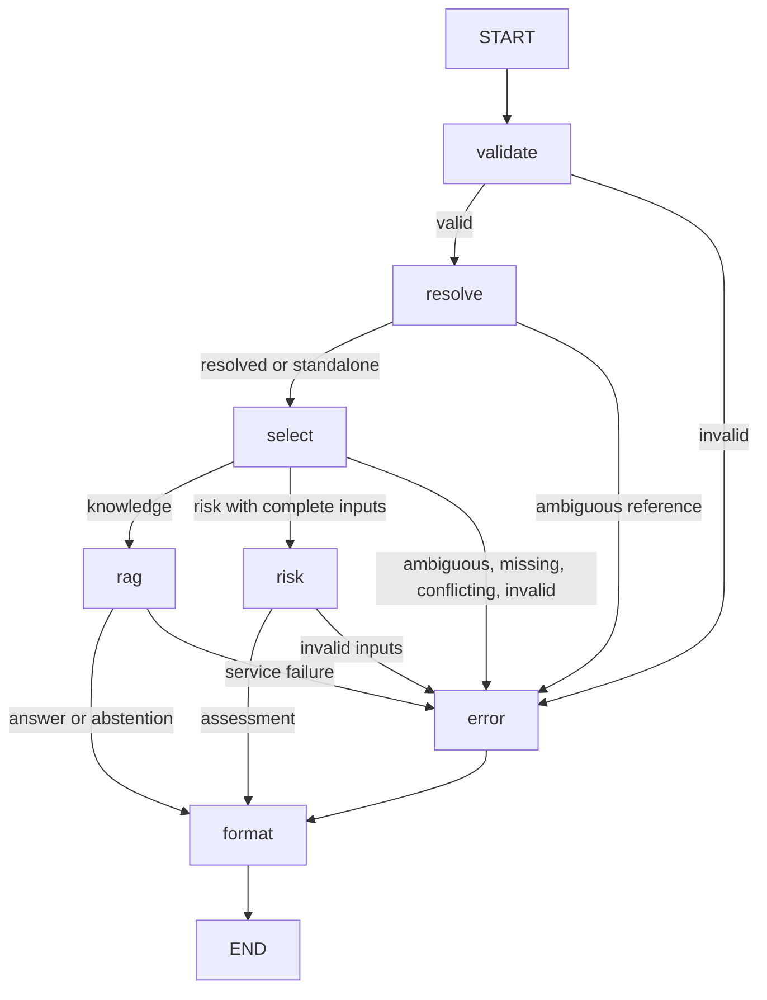

# CyberSage

Cybersecurity RAG intelligence backend using Python 3.12, FastAPI, PostgreSQL 17,
and pgvector. Local PDF ingestion and semantic evidence retrieval are implemented.
Grounded extractive RAG answers are available through Groq. A dedicated Next.js
frontend now provides a responsive intelligence workspace, source catalog,
assistant interface, and interactive risk matrix.

## Frontend workspace (Milestones 10–11)

`frontend/` uses Next.js App Router, strict TypeScript, Tailwind CSS, locally owned
shadcn/ui components with Radix primitives, Lucide icons, and Motion for React.
Manrope/Inter fonts are self-hosted through installed font packages. There are no
remote font requests or bundled example AI answers.

With Node.js 24 LTS and npm installed, from the repository root:

```powershell
cd frontend
npm.cmd ci
if (!(Test-Path .env.local)) { Copy-Item .env.example .env.local }
npm.cmd run dev -- --hostname 127.0.0.1
```

Open `http://127.0.0.1:3000`. If that port is occupied, add `--port 3100` to the
development command. On other operating systems, use `npm` instead of `npm.cmd`.
On this Windows machine, the `.cmd` executable avoids the disabled PowerShell
script execution policy. Backend setup remains documented below; run FastAPI
separately. The frontend never calls Groq directly.

`frontend/.env.local` contains only the API location:

```dotenv
FASTAPI_BASE_URL=http://127.0.0.1:8000
```

The default client sends same-origin `/api/v1/*` requests; Next.js rewrites those
requests to FastAPI. This is a transport proxy, not another application backend.
Restart Next.js after changing the target (rebuild for a production build).
No FastAPI CORS change is needed in this mode. Optional direct browser access
through `NEXT_PUBLIC_API_BASE_URL` requires the backend to explicitly allow the
frontend origin through CORS; that backend configuration is not added here.
Never expose provider keys or database credentials in frontend environment
variables, especially `NEXT_PUBLIC_*` values.

| Page | Purpose |
|---|---|
| `/` | Overview, corpus snapshot, assistant and assessment entry points |
| `/assistant` | Agent request UI, citations, history, retry and local recent shortcuts |
| `/risk-analyzer` | Local 5×5 preview plus authoritative server-confirmed assessment |
| `/knowledge-base` | Searchable/filterable catalog of the three actual sources |
| `/about` | Architecture, grounding, memory and limitations |

Assistant/history requests, server-confirmed risk assessments and health checks
use the existing API with typed contracts, runtime response checks and safe errors.
Milestone 11 adds separate real-service browser validation; deterministic tests
continue to use explicit fixtures. See [full-stack integration](docs/milestone11-integration.md)
for actual results, screenshot paths and startup instructions.
Health indicates FastAPI reachability only, not database/provider
readiness. The catalog is a labeled Milestone 9 snapshot, not a live inventory.
There are no source upload/delete/download controls or simulated answers.

Conversation IDs grant access to history because authentication is not yet
implemented. Recent IDs, titles and timestamps are stored locally in this
browser (maximum eight); answers are fetched from PostgreSQL. Clearing shortcuts
does not delete server history. Avoid sensitive questions on shared machines.

Frontend validation, from `frontend/`:

```powershell
npm.cmd run build
npm.cmd run typecheck
npm.cmd run lint
npm.cmd test
$env:PLAYWRIGHT_BROWSERS_PATH = Join-Path (Get-Location) '.cache\playwright'
npm.cmd exec -- playwright install chromium
npm.cmd run test:e2e
npm.cmd audit
```

Browser tests start the production app on port 3100 and stop it afterward. See
[Milestone 10 frontend](docs/milestone10-frontend.md) for architecture, validation,
design decisions, screenshots and the Milestone 11 checklist.

## Bounded LangGraph cybersecurity agent

`POST /api/v1/agent/invoke` offers two fixed capabilities: existing document-grounded
RAG and a deterministic illustrative risk matrix. A single `StateGraph` uses an
explicit typed state and the following acyclic transitions:



The normal path executes five nodes; a service failure executes six. Every path
ends at `END`, with an additional fixed **eight-step recursion guard**. There are
no loop edges, tool-call feedback loops, graph checkpointers, or multi-agent
components. PostgreSQL conversation memory is described below. Only the formatted response is returned, never graph
state or raw exceptions. The execution guard bounds graph steps, not total
wall-clock latency; existing Groq per-request timeouts still apply to RAG calls.

Routing is deterministic and uses conservative English cues. Named source terms
(NIST, CSF, policy, framework, casebook, document) select knowledge; cybersecurity
questions can also select knowledge. Explicit calculation commands or supplied
likelihood/impact fields select risk. Numerical requests mixed with source
questions, unknown requests, and conflicting inputs return clarification without
calling RAG. Conceptual/ambiguous risk questions may need to be restated. There is
no LLM intent classifier. Keyword routing is intentionally limited and may require
users to rephrase; it is not a general natural-language intent recognizer.

For risk, use structured fields or explicitly labeled English inputs such as
`Calculate risk for an asset with likelihood 4 and impact 5.` The text parser
supports a single digit 1..5 after each label (optionally `:`, `=`, `is`, or `of`).
It rejects decimals, ranges, written-out numbers, repeated labels, and conflicts
between text and structured fields. Unlabeled numbers are never guessed. Missing
inputs are reported rather than inferred. JSON numbers must be actual integers
1..5; booleans, floats, and numeric strings are invalid. Message length and top-k
bounds remain 1..2000 stripped characters and integer 1..20, default top-k 5.

### Illustrative risk matrix

**Score = Likelihood × Impact**, where both inputs are integers 1..5:

| Score | Category |
|---|---|
| 1–5 | Low |
| 6–10 | Medium |
| 11–15 | High |
| 16–25 | Critical |

This is an **illustrative qualitative scoring matrix, not a validated prediction
of real-world cyber risk**. It does not estimate probabilities, losses, compliance,
or a calibrated asset risk level. The pure Python tool calculates the score and
category. No LLM calculates, changes, or overrides them, and risk responses have
no PDF citations or model identifier. The pure risk tool requires no database or
provider; the agent API now requires PostgreSQL to persist its conversation turns.

### Agent API examples

```powershell
$body = @{ message = 'What does NIST CSF 2.0 say about incident response?' } | ConvertTo-Json
Invoke-RestMethod -Method Post -Uri http://127.0.0.1:8000/api/v1/agent/invoke -ContentType application/json -Body $body

$body = @{ message = 'Calculate risk'; likelihood = 4; impact = 5 } | ConvertTo-Json
Invoke-RestMethod -Method Post -Uri http://127.0.0.1:8000/api/v1/agent/invoke -ContentType application/json -Body $body
```

Risk response (core fields; conversation metadata is described below):

```json
{
  "capability": "risk",
  "status": "assessed",
  "answer": null,
  "assessment": {
    "likelihood": 4,
    "impact": 5,
    "score": 20,
    "category": "Critical",
    "interpretation": "Likelihood 4/5 and impact 5/5 produce 20/25, classified as Critical in this illustrative matrix.",
    "disclaimer": "Illustrative qualitative matrix; not a validated prediction of real-world cyber risk."
  },
  "citations": [],
  "error": null,
  "model": null,
  "retrieved_evidence_count": 0,
  "selected_evidence_count": 0,
  "abstention_reason": null
}
```

Knowledge responses have `capability: "knowledge"`, an answer, existing RAG
citations/counts/model, and `assessment: null`. The agent reuses the complete RAG
service, including quotation/ID/relevance checks, synthetic incident labels,
and `insufficient_evidence` abstention; it does not reconstruct or invent citations.

Missing inputs and ambiguous requests return HTTP 200 with `missing_input` or
`needs_clarification` and a public `error` object (`code`, `message`,
`missing_inputs`). Schema-invalid requests return FastAPI HTTP 422. Invalid
numbers parsed from otherwise valid text return 422 with `status: "invalid_input"`
and the agent response schema. Knowledge provider/retrieval failures retain safe
503 responses and provider timeouts 504; unexpected/step-limit failures return
safe 500 responses. Failures do not fall back to a guessed score or fabricated
answer. The risk tool never queries documents or calls a provider; conversation
storage still uses the database.

No shell, filesystem, arbitrary network, user-defined tools, or dynamic execution
tools are exposed. User text only selects among fixed capabilities; retrieved
text remains untrusted within the existing RAG service. No authentication,
frontend, external automation, user profiling, or deployment is included.

From `backend/`, run the optional real smoke check:

```powershell
$env:HF_HOME = Join-Path (Get-Location) '.cache\huggingface'
# Use HF_HUB_OFFLINE=1 only when model weights are already cached.
.\.venv\Scripts\python.exe test_agent_manual.py
```

It checks all four risk categories, invalid/missing/ambiguous requests, and (when
Groq credentials exist) one real grounded question and a Mars abstention, with
65-second pacing. Citations are checked against both PostgreSQL and raw PDF pages.
See [Milestone 7 validation](docs/milestone7-validation.md) for actual results.

## Persistent conversation memory

Milestone 8 adds conversation-scoped PostgreSQL history around the existing
agent. Requests without a conversation ID still work and now receive a new
`conversation_id` and `request_id`. Send the returned conversation ID for a
follow-up. The response also includes `resolved_message` and `context_used` so
the fresh retrieval question can be inspected without exposing graph state.

```powershell
$first = Invoke-RestMethod -Method Post -Uri http://127.0.0.1:8000/api/v1/agent/invoke -ContentType application/json -Body (@{
    message = 'What does NIST CSF 2.0 say about incident response?'
    request_id = [guid]::NewGuid().ToString()
} | ConvertTo-Json)
$followup = Invoke-RestMethod -Method Post -Uri http://127.0.0.1:8000/api/v1/agent/invoke -ContentType application/json -Body (@{
    message = 'What about recovery?'
    conversation_id = $first.conversation_id
    request_id = [guid]::NewGuid().ToString()
} | ConvertTo-Json)
$followup.resolved_message  # What does NIST CSF 2.0 say about recovery?
```

The `resolve` graph node runs before capability routing and RAG retrieval. It
uses only bounded recent user questions and server-recorded resolved questions,
capabilities, and statuses. It **never uses prior assistant answer prose, scores,
or citations as factual evidence** and never adds history to the RAG prompt.
Every new knowledge turn retrieves document evidence afresh. Retries with a
committed request ID replay the original response instead of calling RAG again.

Deterministic source aliases currently cover NIST/CSF, Pakistan's named policy,
and the CyberSage casebook. `What about recovery?` can use the immediately recent
NIST source; `What response measures does it describe?` can substitute the recent
Pakistan policy. Explicit standalone source questions do not need resolution.
Multiple possible sources, a missing source, unsupported deictic references, or
a preceding risk/clarification turn require clarification. No resolution LLM is
called. This conservative resolver does not claim general co-reference handling.
Risk calculations always require current-turn numbers; previous likelihood or
impact values are never inherited.

`MEMORY_HISTORY_TURNS=6` and `MEMORY_HISTORY_CHARS=8000` bound the internal history
projection. Whole recent turns are retained until either limit is met. Assistant
answer bodies are not loaded into this context projection. Stored history is
durable and is not automatically expired; these limits bound context, not disk
retention. A bounded projection that cannot identify a source safely abstains
from resolution and requests clarification.

### Storage and consistency

Migration `002_conversational_memory.sql` adds only:

- `conversations`: UUID, revision, creation/update timestamps.
- `conversation_turns`: globally unique request UUID, conversation FK, monotonic
  turn number, SHA-256 request fingerprint, timestamp, per-conversation uniqueness.
- `conversation_messages`: UUID, conversation/request composite FK, user/assistant
  role, original validated message or public assistant output, JSONB public
  response metadata, timestamp, one message per request/role.

Original user text is stored as validated/trimmed by the existing API, **not** as
its contextual rewrite. Assistant metadata retains citations, assessment/status,
model ID, resolved question, and context-use flag. Internal system prompts,
provider diagnostics, API credentials, and graph state are not stored. Messages
containing a configured credential or obvious Groq API-key pattern are rejected
before inference or storage; responses with detected credentials are not stored.
This is not a general sensitive-data detector: do not enter personal secrets or
confidential incident details into an unauthenticated demo.

Each completed response (including honest clarification, missing-input responses,
and insufficient evidence) is saved with its user message in one transaction.
Provider/graph errors and invalid requests save neither message. New conversation
rows are created only when a turn commits; a failed new request has no conversation
ID. Failure in the final database transaction withholds the generated answer and
returns safe 503 rather than reporting an unsaved success. Documents/chunks remain
unchanged. Application startup never silently creates or alters tables.

For retry safety, generate a `request_id` once per logical turn and reuse it with
the exact same message, risk inputs, top-k, and conversation ID. If the initial
new-conversation response is lost, retrying the same request ID without a
conversation ID recovers the committed response/ID. Changed inputs or another
conversation produce 409, never another conversation's answer. If no client
request ID was supplied and its generated value is lost, automatic deduplication
cannot be guaranteed. Repeated questions with new request IDs are legitimate new
turns. Corrected messages after a committed clarification need a new request ID.

The history snapshot uses a short shared row lock. No database transaction remains
open during model calls. Final writes compare the conversation revision: one of
two concurrent turns wins; the other returns 409 without saving its generated
answer. The client may retry against fresh history. Concurrent retries of the
same request ID replay one committed result. Duplicate model work can still occur
before the write race is detected; requests within one conversation should be
sent sequentially. A concurrent document ingestion is independent of turn storage.

### Bounded history endpoint and privacy

```powershell
Invoke-RestMethod -Uri "http://127.0.0.1:8000/api/v1/conversations/$($first.conversation_id)/messages?limit=10"
```

`GET /api/v1/conversations/{uuid}/messages` returns the latest `limit` **turns**
(default 10, maximum 20; two messages per turn), in chronological order. It returns
`has_more` and `next_before_turn`; supply `before_turn` to page backward. Unknown
UUIDs return 404 and malformed IDs return 422. There is no endpoint to enumerate
conversations. Conversation/storage failures return safe 404/409/503 errors.

**There is no authentication or ownership check.** Anyone with a conversation ID
can read and continue it. A request ID also acts as a replay capability for its
original request. Treat these high-entropy identifiers as access secrets; URLs
may appear in access logs. This is suitable only for a local demonstration until
authentication/authorization and a retention policy are implemented. Conversation
IDs scope queries and prevent accidental cross-conversation context mixing; they
do not establish user identity or authorization.

For the restart smoke check, start the API on localhost:8001 and run
`python test_memory_manual.py --phase start` from `backend/`. Restart the API and
run `--phase resume`. The script paces Groq calls, records IDs in ignored `.cache/`,
checks original messages and citations, and verifies history/replay after restart.
See [Milestone 8 validation](docs/milestone8-validation.md) for measured results.

## Local setup (PowerShell)

Create a repository-root `.env` using `.env.example` and set a nonempty local
password. For an existing database volume, use its existing credentials: changing
Compose variables does not change passwords stored in that volume. Never commit
`.env`, source PDFs, model weights, or virtual environments.

```powershell
docker compose up -d db
python -m venv backend/.venv
cd backend
.\.venv\Scripts\python.exe -m pip install -r requirements.txt
```

An existing backend environment can be reused. Settings load root `.env`, then
`backend/.env`, then process environment variables (highest priority). Optional
backend settings are shown in `backend/.env.example`. The default database address
is `127.0.0.1:5433`, matching Compose. When running the backend inside Docker, set
`POSTGRES_HOST=db` and `POSTGRES_PORT=5432`. Credentials are passed using
SQLAlchemy's URL builder, so special password characters need no manual escaping.

For a **new** database, apply the existing migration once from the repository root:

```powershell
Get-Content -Raw backend/migrations/001_initial_schema.sql | docker compose exec -T db sh -c 'psql -v ON_ERROR_STOP=1 -U "$POSTGRES_USER" -d "$POSTGRES_DB"'
Get-Content -Raw backend/migrations/002_conversational_memory.sql | docker compose exec -T db sh -c 'psql -v ON_ERROR_STOP=1 -U "$POSTGRES_USER" -d "$POSTGRES_DB"'
```

For an existing Milestone 7 database, apply **only 002** once. Its explicit
transaction installs three new tables without changing documents/chunks. A repeat
application fails rather than silently replacing an existing memory schema.

The ingestion command never creates or changes schema. Check an existing database
from `backend/`:

```powershell
.\.venv\Scripts\python.exe -m app.ingestion --check-db
```

## Ingest PDFs

Put the source PDFs in `data/raw/` (ignored by Git). From `backend/`:

```powershell
$env:HF_HOME = Join-Path (Get-Location) '.cache\huggingface'
.\.venv\Scripts\python.exe test_embeddings_manual.py
.\.venv\Scripts\python.exe -m app.ingestion
.\.venv\Scripts\python.exe -m app.ingestion --verify
```

The first model use may download `sentence-transformers/all-MiniLM-L6-v2`.
If the model is already fully cached and you need offline operation, set
`$env:HF_HUB_OFFLINE = '1'` before running the commands.
Subsequent calls in one process reuse the loaded model; subsequent processes reuse
downloaded weights. The model produces normalized vectors with 384 values.
`embed_texts(texts, batch_size=32)` encodes a list in order. Empty lists return `[]`;
blank texts, invalid types, and nonpositive batch sizes are rejected.

The CLI discovers `.pdf` files directly in `data/raw/`, sorted by name. It prints
per-file results and counts of documents processed/skipped, chunks inserted, and
failures. Override defaults with `--input-dir PATH --batch-size 16`. It returns a
nonzero exit code for failures, missing/empty input directories, or unsuccessful
verification. Errors show their type without printing SQL parameters or secrets.

SHA-256 identifies documents by file contents, so renamed copies are skipped after
indexing. Changed contents form a new document; existing records are not removed.
Failed/pending documents can be retried. A PostgreSQL transaction lock serializes
workers for the same hash. Each document uses its own transaction and savepoint:
chunk replacement and `indexed` status commit together, or processing writes roll
back and the document becomes `failed`. An interrupted process rolls back its
transaction. Other PDFs continue after a per-document failure. `processing` is an
intermediate transactional value, not a separately committed progress indicator.

Page references retain original PDF numbering, including gaps caused by blank
pages. `page_count` records total PDF pages. A PDF without extractable text fails;
OCR is not included. Verification reports both database-wide totals and records
matching current source hashes, checking dimensions, vector norms, page bounds,
duplicate chunk indices, and missing parent records. It does not delete any data.
For the original three source PDFs, the expected result is 3 indexed documents and
206 chunks. Other existing records may make database-wide totals larger.

## Tests

From `backend/`, ordinary unit tests require no model download or database:

```powershell
.\.venv\Scripts\python.exe -m pytest tests -q -p no:cacheprovider --basetemp=.cache/pytest-unit
```

Run PostgreSQL tests explicitly against the configured database:

```powershell
$env:CYBERSAGE_TEST_POSTGRES = '1'
.\.venv\Scripts\python.exe -m pytest tests -q -p no:cacheprovider --basetemp=.cache/pytest-postgres
Remove-Item Env:CYBERSAGE_TEST_POSTGRES
```

Integration tests reuse the real migration constraints in temporary tables and
roll back their transactions; existing document data is untouched. They test real
pgvector writes, duplicate handling, page references, foreign keys, dimension
constraints, rollback after partial writes, and retries. Real-model behavior is
checked separately by the smoke script and end-to-end ingestion.

Start the API from `backend/`:

```powershell
.\.venv\Scripts\python.exe -m uvicorn app.main:app --reload
```

The existing health endpoint is `GET /api/v1/health`.

## Semantic retrieval and PDF citations

`POST /api/v1/retrieval/search` embeds the query using the same cached MiniLM
model as ingestion. SQLAlchemy binds the vector, threshold, and result limit to a
read-only pgvector cosine search joined to document metadata. Only `indexed`
documents are searched. Each result includes content, chunk/document UUIDs,
stored document title (nullable), filename, original PDF page number, chunk index,
cosine distance, similarity score, and structured citation metadata.

For this 206-chunk corpus, a materialized scoring CTE performs **exact** search
before filtering and limiting. It deliberately does not use approximate HNSW
candidate selection. Equal distances sort by document UUID, chunk index, and
chunk UUID for deterministic results. This scans the full indexed corpus; larger
collections will need performance evaluation before changing the search strategy.

Cosine distance ranges from 0 to 2 (smaller is closer); cosine similarity is
`1 - cosine_distance`, ranging from -1 to 1 (larger is closer). Similarity is a
retrieval signal, **not a probability of correctness or proof of relevance**.
The permissive initial threshold is `RETRIEVAL_MIN_SIMILARITY=0.2`, configurable
in environment settings. Optional request/CLI `min_similarity` overrides it for
that search. The cutoff is inclusive. Results below the cutoff are excluded before
top-k; fewer than top-k results, including zero, are valid. No fallback evidence is
fabricated. Threshold tuning requires a representative evaluation set.

Queries are stripped and must contain 1..2000 characters. `top_k` defaults to 5
and must be an integer from 1 to 20. Similarity cutoffs must be finite and in
[-1, 1]. Invalid API requests return 422. Database/model failures return a generic
503 without connection details, SQL parameters, or secrets. An empty successful
search returns 200 with `results: []` and `result_count: 0`. Startup/health checks
do not load the model or connect to PostgreSQL. Retrieval creates a shared engine
lazily and disposes it on shutdown; synchronous work runs in a worker thread.

Citation labels use a nonblank stored `documents.title`, falling back to the
**exact filename** when no title is stored. `title_source` explicitly reports
`metadata` or `filename`. The existing three documents have null titles, so their
labels use filenames; retrieval does not infer or write titles. Document UUIDs
and filenames distinguish sources even if their titles or content overlap.
Pages are **1-based PDF page positions**, including front matter; printed page
labels may differ. No page number is inferred from chunk text.

From `backend/`, with the API running on its default port:

```powershell
$body = @{ query = 'How does NIST CSF 2.0 address incident response?'; top_k = 1 } | ConvertTo-Json
Invoke-RestMethod -Method Post -Uri http://127.0.0.1:8000/api/v1/retrieval/search -ContentType application/json -Body $body
```

Example response from the existing corpus (only `content` shortened for readability):

```json
{
  "query": "How does NIST CSF 2.0 address incident response?",
  "results": [
    {
      "chunk_id": "45eebff5-cd2b-40b6-879d-f1161f0d7452",
      "document_id": "7bc85d48-0606-4e6b-aa7e-f453e59cca0a",
      "document_title": null,
      "filename": "NIST.CSWP.29.pdf",
      "page_number": 27,
      "chunk_index": 76,
      "content": "...RESPOND (RS): Actions regarding a detected cybersecurity incident are taken...",
      "cosine_distance": 0.36449939012527466,
      "similarity_score": 0.6355006098747253,
      "citation": {
        "document_id": "7bc85d48-0606-4e6b-aa7e-f453e59cca0a",
        "document_title": null,
        "filename": "NIST.CSWP.29.pdf",
        "page_number": 27,
        "display_title": "NIST.CSWP.29.pdf",
        "title_source": "filename",
        "label": "[NIST.CSWP.29.pdf, p. 27]"
      }
    }
  ],
  "result_count": 1,
  "min_similarity": 0.2
}
```

CLI searches (from `backend/`):

```powershell
$env:HF_HOME = Join-Path (Get-Location) '.cache\huggingface'
# Set HF_HUB_OFFLINE=1 only if the model is already fully cached.
.\.venv\Scripts\python.exe -m app.retrieval --query "What does Pakistan's cyber security policy say about critical infrastructure?" --top-k 5
.\.venv\Scripts\python.exe -m app.retrieval --query "How does NIST CSF 2.0 address incident response?" --top-k 5
.\.venv\Scripts\python.exe -m app.retrieval --query "What happened in the ransomware incidents described in the CyberSage casebook?" --top-k 5
.\.venv\Scripts\python.exe -m app.retrieval --query "incident response" --min-similarity 0.4
.\.venv\Scripts\python.exe test_retrieval_manual.py
```

CLI output is JSON; exit codes are 0 for success (including no evidence), 2 for
invalid arguments, and 1 for an unavailable model/database. The manual script
uses the actual API, model, database, and raw PDFs to check all 15 sample passage
citations against their original page text. It also checks empty evidence and
invalid requests. This checks provenance, not semantic relevance. Ordinary
tests mock model inference; opt-in PostgreSQL tests use known vectors to check
distances, negative similarities, thresholds, exact ranking, ties, metadata, and
exclusion of failed documents. No new dependencies are required for retrieval.

See [Milestone 5 validation](docs/milestone5-validation.md) for measured rankings,
page checks, and observed relevance limitations.

## Grounded RAG answers (Groq)

`POST /api/v1/rag/ask` reuses the existing retrieval service and database engine.
The orchestration depends on a small provider protocol under `app/llm/`; only the
Groq adapter imports the official Groq SDK. Retrieval and ingestion do not depend
on Groq credentials or calls. Install updated requirements in the backend venv.

Set `GROQ_API_KEY` in an ignored root/backend `.env` or process environment.
Never put a real key in `.env.example`, source code, logs, or Git. Other settings
and defaults are:

| Setting | Default | Purpose |
|---|---|---|
| `GROQ_MODEL` | `openai/gpt-oss-120b` | Configurable text model hosted by Groq |
| `GROQ_TEMPERATURE` | `0` | Low-variance evidence selection |
| `GROQ_TIMEOUT_SECONDS` | `30` | Timeout per provider request |
| `GROQ_MAX_OUTPUT_TOKENS` | `2048` | Maximum completion tokens per generation/review call |
| `RAG_MAX_RETRIEVED_CHUNKS` | `8` | Cap on requested retrieval count; never exceeds retrieval's hard limit of 20 |
| `RAG_MAX_CONTEXT_CHARS` | `8000` | Maximum serialized evidence-array characters, including IDs and source kinds |
| `RAG_MAX_PROMPT_CHARS` | `24000` | Maximum combined system and serialized payload characters per call |

The default model was selected from Groq's current
[production model list](https://console.groq.com/docs/models), considering its
[deprecation notices](https://console.groq.com/docs/deprecations). Availability
depends on the account and may change. The adapter retrieves the configured model
from the account's active model list before its first completion and caches a successful validation. It does
not silently switch models. JSON-object mode supports a replaceable text model;
local Pydantic checks enforce the expected schema. Truncated/malformed output
causes abstention. SDK retries are disabled to bound repeated attempts; timeouts,
rate limits, model/authentication failures, and connection failures produce safe
errors without provider response bodies or credentials.

### Conservative answer and citation contract

The initial answer mode is deliberately **extractive**, not unrestricted prose
generation. The model selects up to five meaningful source excerpts. The server:

1. Retrieves relevant chunks using the configured retrieval similarity cutoff.
   Request `top_k` defaults to 5 (valid range 1..20), capped by the RAG setting.
2. Selects whole passages within the context budget, deduplicating identical or
   contained text and quarantining obvious embedded instruction attacks. No whole
   documents are sent. The question and passages are serialized as untrusted user
   data, separate from trusted system instructions; no LLM tools are enabled.
3. Assigns stable `E_<chunk UUID without hyphens>` evidence IDs. The model supplies
   IDs and quotes only; it never supplies authoritative filenames, titles, or pages.
4. Requires every cited ID to belong to the selected context and every quote to
   occur verbatim after whitespace normalization. Invented prose, extra output
   fields, unknown IDs, altered claims, and incomplete outputs fail closed.
5. Makes a second model call to review all quotes in their evidence context for
   support, relevance, and misleading omissions. Any failed/uncertain verdict or
   mismatched ID set causes abstention. This is a second check by the **same
   model**, not an independent factual verifier.
6. Renders only validated quotes with database-derived citations and local source
   labels. Policy text is labeled as a policy source, not automatically a binding
   requirement; NIST/framework passages are guidance. The known synthetic casebook
   is explicitly labeled **not a real event**. Unknown source types remain unverified.

Citation objects contain document/chunk UUIDs, filename, nullable stored title,
PDF page number, chunk index, evidence ID, exact supporting quote, source kind,
and display label. Only used excerpts become citations. Printed page labels may
differ from physical PDF page positions. Missing titles use the exact filename.

**ID validity and quote membership are mechanical checks, not proof of factual
entailment, relevance, truth, or completeness.** A source can itself be wrong;
quotes can omit context; the relevance model can be wrong or manipulated. The
instruction-pattern filter is defense in depth and can miss attacks or reject
legitimate discussions of them. Source-kind classification uses local metadata
and content cues, not independent provenance verification. This conservative mode
trades prose synthesis and some answer coverage for tighter citation integrity.
The existing permissive 0.2 similarity cutoff is not a sufficient relevance gate;
neither its scores nor the review verdict are calibrated correctness probabilities.

Budgets are character limits on serialized input, not exact tokenizer counts.
Output token limits are enforced by the provider. Up to three provider requests
may occur on first use (model validation, selection, review); subsequent answered
requests normally use two. Each has its own timeout; the setting is not an
end-to-end request deadline. Source passages are sent to Groq when generation is
used; credentials and database connection details are not part of prompts.

### Ask endpoint

With the API running, send:

```powershell
$body = @{ question = 'How does NIST CSF 2.0 address incident response?'; top_k = 5 } | ConvertTo-Json
Invoke-RestMethod -Method Post -Uri http://127.0.0.1:8000/api/v1/rag/ask -ContentType application/json -Body $body
```

An illustrative grounded response (shape example, **not a live Groq result**;
IDs below refer to the existing NIST chunk):

```json
{
  "question": "How does NIST CSF 2.0 address incident response?",
  "answer": "Framework guidance: \"The incident response plan is executed in coordination with relevant third parties once an incident is declared\" [NIST.CSWP.29.pdf, p. 27] (E_45eebff5cd2b40b6879df1161f0d7452)",
  "status": "answered",
  "citations": [{
    "document_id": "7bc85d48-0606-4e6b-aa7e-f453e59cca0a",
    "chunk_id": "45eebff5-cd2b-40b6-879d-f1161f0d7452",
    "document_title": null,
    "filename": "NIST.CSWP.29.pdf",
    "page_number": 27,
    "chunk_index": 76,
    "evidence_id": "E_45eebff5cd2b40b6879df1161f0d7452",
    "quote": "The incident response plan is executed in coordination with relevant third parties once an incident is declared",
    "source_kind": "framework",
    "display_title": "NIST.CSWP.29.pdf",
    "title_source": "filename",
    "label": "[NIST.CSWP.29.pdf, p. 27]"
  }],
  "retrieved_evidence_count": 5,
  "selected_evidence_count": 5,
  "model": "openai/gpt-oss-120b",
  "grounding_mode": "verified_excerpts",
  "abstention_reason": null
}
```

No evidence, unusable/budget-exceeding context, model abstention, rejected
citations/quotes, or a negative relevance verdict return HTTP 200 with
`status: "insufficient_evidence"`, a fixed explanation, `citations: []`, and a
safe `abstention_reason`. No-evidence responses do not call Groq and have a null
model. Missing/invalid credentials and unavailable providers are operational
failures: HTTP 503, **not** an insufficient-evidence result. Provider timeouts
return 504. Invalid questions/top-k return 422, using the same strict bounds as
retrieval. Partial answers are not returned after a validation failure.

From `backend/`, run the live smoke check when a key is available:

```powershell
.\.venv\Scripts\python.exe test_rag_manual.py
```

The script asks the three corpus questions and an unanswerable Mars-policy
question, checks source quotes against cited raw PDF pages, and records answers
for manual relevance review. It prints `skipped_missing_credentials` without
making provider calls when no key is configured. Automated tests always mock
external model calls. The live script spaces questions 65 seconds apart to reduce
per-minute token throttling; it normally takes several minutes. Production API
calls still fail safely on rate limits without automatic retries. See
[Milestone 6 validation](docs/milestone6-validation.md).

## Milestone 9: evaluation and assignment evidence

The evaluation dataset contains exactly eight answerable questions across all
three PDFs and two unanswerable questions. Ground-truth criteria and PDF pages
are verified against the local source files before a run. The runner uses the
existing agent API with independent conversations, records actual answers and
diagnostic retrieval, and spaces questions 65 seconds apart.

With the existing API running on port 8001, from `backend/`:

```powershell
.\.venv\Scripts\python.exe -m evaluation --output evaluation/results/new-run.json
.\.venv\Scripts\python.exe -m evaluation.extra --output evaluation/results/new-supplementary.json
```

Choose a new output path rather than overwrite recorded evidence. `--resume`
only fills unexecuted questions. Missing credentials/provider errors make a run
incomplete. The separate supplementary command exercises risk categories,
invalid inputs and a real two-turn memory conversation. It stores private access
IDs only under ignored `.cache/`; public artifacts redact them.

After manually reviewing a new run against the dataset, create a matching review
file following `evaluation/reviews.json` (including each `response_sha256` from
`evaluation.report.response_hash`). Render it with:

```powershell
.\.venv\Scripts\python.exe -m evaluation.report --results evaluation/results/new-run.json --reviews evaluation/new-reviews.json --output ../docs/new-results.md
$env:CYBERSAGE_TEST_POSTGRES = '1'
.\.venv\Scripts\python.exe -m pytest tests -q -p no:cacheprovider --basetemp=.cache/pytest-evaluation
.\.venv\Scripts\python.exe -m pip check
```

The recorded live run produced six answers, two correct abstentions, two
incorrect abstentions, and one incomplete answer among the six answers. All 12
returned citations had valid database/PDF provenance; reviewed coverage was
15/21 criteria. Provenance is evaluated separately from factual support and
completeness. See [Milestone 9 evaluation and failure analysis](docs/milestone9-evaluation.md)
and [all ten recorded answers](docs/milestone9-results.md), including actual
limitations and assignment screenshot instructions. No screenshot is claimed.

## Milestone 4 validation (2026-11-12)

Validated locally with PostgreSQL 17.11, pgvector 0.8.7, SQLAlchemy 2.1.8,
psycopg 3.3.8, and sentence-transformers 6.3.0:

- Full suite: **45 passed**, including five real PostgreSQL integration tests.
- Ordinary offline suite: **40 passed, 5 integration tests skipped** as intended.
- Real-model smoke test: 384 dimensions, L2 norm 1.000000.
- Database baseline: 0 documents, 0 chunks. No existing records were removed.
- First ingestion: 3 documents indexed, 206 chunks inserted, 0 failures.
- Second ingestion: 3 documents skipped, 0 chunks inserted, 0 failures.
- Stored documents: national policy 22 pages / 52 chunks, incident casebook
  21 pages / 61 chunks, NIST CSF 32 pages / 93 chunks. All have status `indexed`.
- Verification: 0 invalid dimensions, page references, vector norms, duplicate
  indices, or orphan chunks. Database totals remained 3 documents / 206 chunks.
- Existing health endpoint, `pip check`, and `git diff --check` passed.

Windows denied access to pytest's default temporary directory in one initial
integration run; the documented project-local `--basetemp` resolved it. Hugging
Face metadata requests were restricted in the sandbox; the real smoke test passed
with approved network access, and ingestion used the fully cached model offline.
