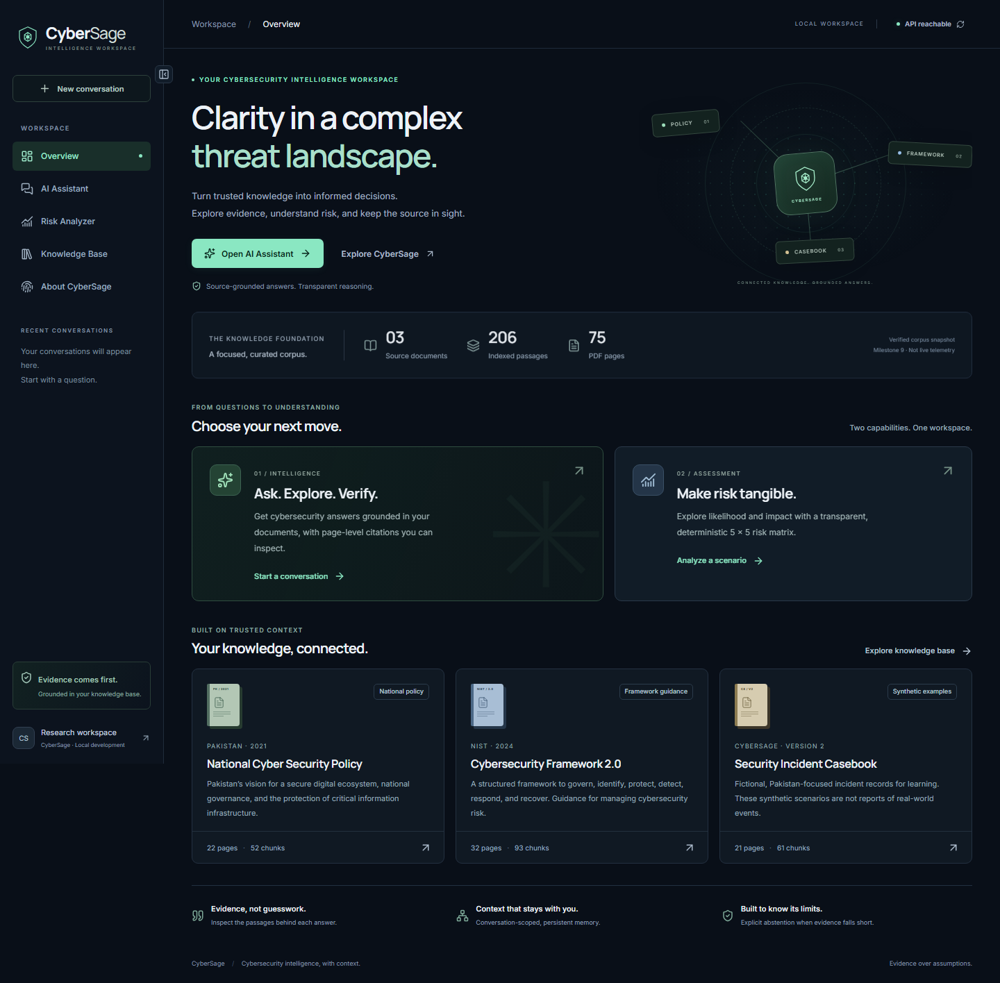
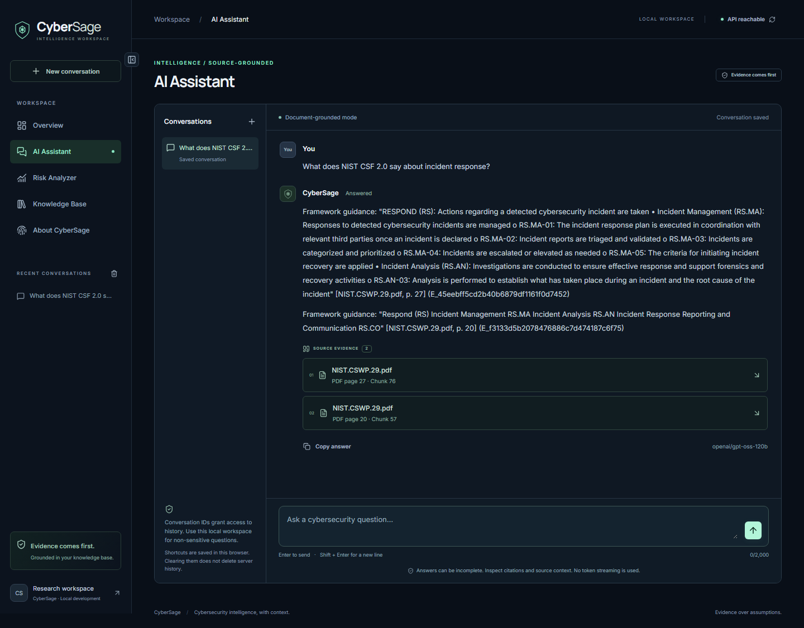
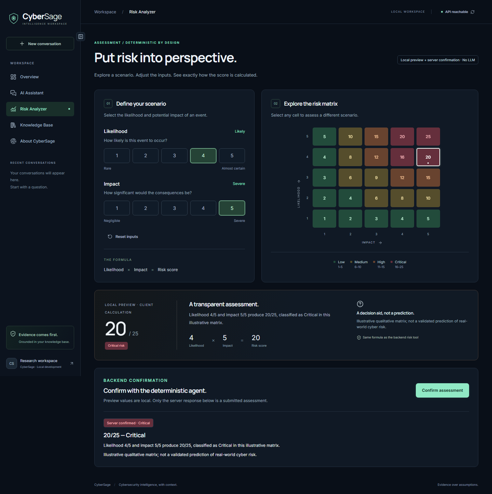
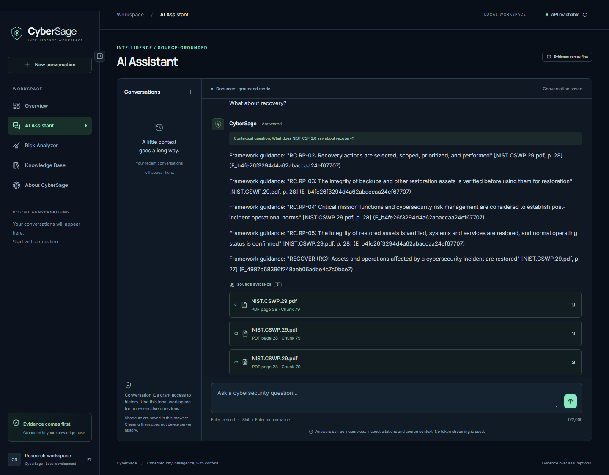
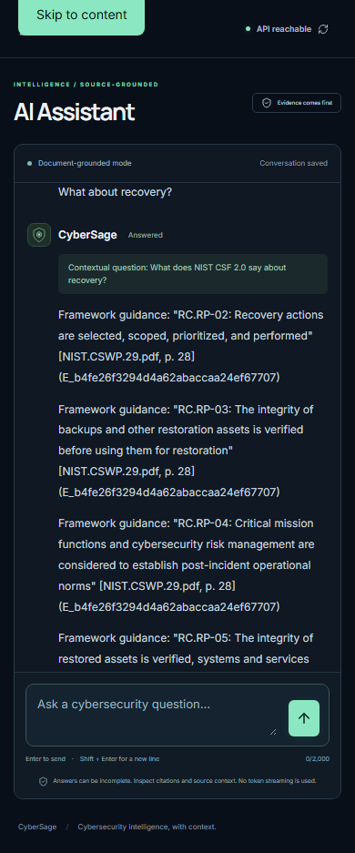

# CyberSage
## Evidence-grounded Cybersecurity RAG Agent

**Final University Assignment Report**

**Student:** [Your Full Name]

**Submission deadline:** November 19, 2026

**Repository:** https://github.com/syedamahnoor-sm/cybersage

**Implementation baseline:** Milestone 11, commit `60d443dd8d4dfb1c87a97dc15397b3a0094d02bd`

Supporting material: [architecture](architecture.md) · [demo guide](demo-guide.md) ·
[submission checklist](submission-checklist.md) · [screenshot provenance](submission-evidence/README.md).

## Executive summary

CyberSage is a full-stack research assistant for exploring cybersecurity policy,
framework guidance and synthetic incident scenarios. It combines a curated PDF
knowledge base, semantic retrieval, source-constrained Groq generation, a bounded
LangGraph agent, deterministic risk assessment and persistent conversational
memory. A responsive Next.js interface exposes the capabilities through FastAPI.

The knowledge base contains three PDFs: 75 physical PDF pages and 206 indexed
chunks. Answers carry database-derived page citations and locally checked source
quotes. When support is inadequate, the assistant can abstain explicitly. A
separate numerical tool calculates likelihood × impact without LLM arithmetic.

The original Milestone 9 evaluation contains exactly eight answerable and two
unanswerable questions. It produced **five complete answer passes, one partial
answer, two incorrect abstentions and two correct abstentions**. Coverage was
15/21 expected criteria (71.4%); all 12 returned citation records had verified
provenance. No unsupported answers were observed during review. These results
demonstrate useful grounding but also retrieval and completeness limitations.
Later successful integration examples are reported separately, without replacing
any original evaluation failure.

## 1. Problem statement and objectives

Cybersecurity information is distributed across documents with different
purposes. A national policy establishes priorities, a framework describes
outcomes, and an incident narrative illustrates a scenario. A general-purpose
chatbot may blur these distinctions, omit source context or produce plausible
but unsupported references. Users also need a simple numerical assessment tool
whose calculations can be inspected directly.

CyberSage's objectives are to:

1. Retrieve relevant passages from a small, documented cybersecurity corpus.
2. Return grounded answers with actual filenames and physical PDF page numbers.
3. Distinguish policy, framework guidance and fictional examples.
4. Resolve bounded conversational follow-ups while retrieving fresh evidence.
5. Provide a transparent deterministic risk-scoring capability.
6. Evaluate both successful answers and failures using an independent-question
   dataset, and expose uncertainty rather than conceal it.
7. Present the system through an accessible, responsive local web workspace.

The application is not a live threat feed, autonomous incident responder or
validated predictor of real-world cyber loss.

## 2. Selected PDFs and selection rationale

| Source | Indexed filename | Pages / chunks | Rationale |
|---|---|---:|---|
| Pakistan National Cyber Security Policy 2021 | `2021-National-Cyber-Security-Policy-Final.pdf` | 22 / 52 | National context: digital ecosystem, governance and critical infrastructure protection |
| NIST Cybersecurity Framework 2.0 | `NIST.CSWP.29.pdf` | 32 / 93 | Structured framework outcomes, including incident response and recovery; precise subcategory references support evaluation |
| CyberSage Security Incident Casebook v2 | `CyberSage_Security_Incident_Casebook_RAG_v2.pdf` | 21 / 61 | Controlled fictional incident examples for querying detection, containment, recovery and illustrative risk records |

The casebook is **synthetic**, not a record of real incidents. It complements
the policy and framework without claiming equivalent authority. This mix also
tests whether the assistant preserves different source classifications.

The original PDFs remain local under `data/raw/`, excluded from Git. The
[evaluation source manifest](../backend/evaluation/results/milestone9.json)
records their SHA-256 hashes and page counts; those hashes and all 21 ground-truth
excerpts were rechecked during submission preparation. Source access therefore
requires the same local files; the repository does not offer PDF uploads,
downloads or a hosted viewer. No evaluation questions were added to the PDFs.

## 3. Technology stack

| Layer | Implemented technologies and role |
|---|---|
| Frontend | Next.js App Router, strict TypeScript, Tailwind CSS, locally owned shadcn/ui components with Radix, Lucide icons, Motion |
| API | Python 3.12, FastAPI and Pydantic request/response validation |
| Agent | LangGraph `StateGraph`, one bounded agent with deterministic routing |
| Retrieval | Sentence Transformers `all-MiniLM-L6-v2`, normalized 384-dimensional embeddings and cosine-distance search |
| Generation | Official Groq Python SDK through a replaceable provider adapter; configured `openai/gpt-oss-120b` |
| Persistence | PostgreSQL 17, pgvector 0.8.7, SQLAlchemy and psycopg |
| Ingestion | PyMuPDF extraction, page-aware chunking, SHA-256 duplicate detection and transactional insertion |
| Validation | pytest, Vitest/Testing Library, Playwright Chromium, axe checks, TypeScript, ESLint and independent citation audits |

Milestone 11 verified the live database as PostgreSQL 17.11 with `vector(384)`
and confirmed the configured model through the Groq account model list. Package
manifests and lockfiles define the installed toolchain; the
[frontend report](milestone10-frontend.md) documents compatibility choices.

## 4. Architecture and RAG pipeline

The [implemented architecture diagram](architecture.md) shows application,
ingestion, retrieval, generation, risk and persistence boundaries. The browser
uses a centralized API client. A same-origin Next.js rewrite forwards existing
`/api/v1/*` requests to FastAPI; the browser never contacts Groq or PostgreSQL.

### Ingestion

The explicit CLI discovers PDFs, hashes each file, checks for existing records,
extracts text with page references, creates page-aware chunks and generates
embeddings in batches. Document and chunk metadata/vectors are stored using
transactions. Repeated ingestion skips already indexed documents rather than
duplicating them. Submission preparation does not reingest or delete the corpus.

### Query and generation

1. Validate and trim the question; reject invalid or blank input.
2. Resolve a reliable follow-up reference from bounded recent user context.
3. Embed the resolved question using the lazily loaded, cached MiniLM model.
4. Search pgvector by cosine distance, join document metadata, apply top-k and
   similarity limits, and use deterministic secondary ordering.
5. Select whole useful passages within context/prompt budgets and deduplicate
   contained/identical evidence where supported.
6. Assign stable evidence IDs and send selected passages as untrusted evidence
   to the modular Groq adapter.
7. Validate returned IDs and exact whitespace-normalized quotes against the
   selected context; obtain a constrained support/relevance verdict.
8. Construct answer excerpts and citations from accepted quotes and stored
   metadata, or return an explicit insufficient-evidence response.

Similarity is **1 − cosine distance**, a retrieval signal rather than a
calibrated correctness probability. The initial threshold is configurable at
0.2. Default maximum retrieved/context/prompt limits are configured centrally;
the original evaluation requested top-k 5. A low threshold does not guarantee
that a particular answer-bearing chunk is retrieved.

Citation-ID validity, quote provenance, relevance and answer completeness are
separate properties. A real quotation can be incomplete or irrelevant. The
support check is conservative but is not a mathematical proof of entailment.

## 5. LangGraph agent and risk tool

The single-agent graph follows:

`validate → resolve → select → rag or risk → format → END`

Invalid, ambiguous or failed operations pass through an explicit error node
before formatting. The graph is acyclic and has an eight-step recursion guard.
It does not execute arbitrary tools, shell commands or autonomous external
actions. Routing uses constrained deterministic cues; mixed or ambiguous
requests can require clarification.

The risk tool strictly accepts integer likelihood and impact ratings from 1 to
5 and calculates:

**Risk score = Likelihood × Impact**

| Score | Category |
|---|---|
| 1–5 | Low |
| 6–10 | Medium |
| 11–15 | High |
| 16–25 | Critical |

The frontend displays a labeled local preview and a separate backend-confirmed
assessment. The backend remains authoritative for submitted assessments. The
recorded live input 4 × 5 returned **20, Critical**, with no PDF citations or
model identifier. Real likelihood 0 was rejected with HTTP 422. Separate
Milestone 9 risk checks covered all four categories and invalid inputs.

This matrix is an **illustrative qualitative decision aid**, not a scientifically
validated probability, loss estimate or prediction. The LLM neither calculates
nor overrides the score.

## 6. Persistent conversational memory

PostgreSQL stores `conversations`, `conversation_turns` and
`conversation_messages`, including roles, timestamps, request IDs, turn numbers
and relevant response metadata. Explicit SQL migrations preserve the existing
document schema. Successful completed turns are committed atomically; failed
provider responses are not saved as misleading assistant turns. Request-ID
replay supports retries without unnecessary duplicate turns.

Each conversation has a unique ID. Follow-ups reuse that ID, and the frontend
places it in the URL so page refresh retrieves persisted history. Recent
shortcuts are bounded local browser references, not a server-wide conversation
listing. History pagination uses the existing endpoint.

Resolution is deterministic and source-scoped. In the recorded live example:

- User: “What does NIST CSF 2.0 say about incident response?”
- Follow-up: “What about recovery?”
- Resolved: “What does NIST CSF 2.0 say about recovery?”

The second turn retrieved new evidence and returned recovery citations.
Refresh restored both turns; the history endpoint returned four messages.
The prior assistant answer was not treated as source evidence. Missing or
ambiguous context requires clarification, and numerical risk inputs are not
inherited from preceding turns. Earlier Milestone 9 memory evidence included a
grounding abstention; that limitation is preserved in its original report.

## 7. Frontend implementation

The five routes are Overview, Assistant, Risk Analyzer, Knowledge Base and About.
The navy/teal design includes an original SVG brand, collapsible desktop sidebar,
mobile drawer, accessible focus states, reduced-motion support, safe Markdown,
loading/error/retry states and inspectable citation excerpts.

Assistant requests use the actual agent contract, stable request IDs and
duplicate-submission guards. Responses appear only when complete; there is no
simulated streaming. Runtime response validation rejects malformed agent,
history, health and assessment structures. Citation expansion is an evidence
detail interaction, not an invented PDF link. The catalog clearly labels its
static corpus snapshot and synthetic casebook.

## 8. Original ten-question evaluation

The dataset contains **exactly 10 independent questions: 8 answerable and 2
unanswerable**, distributed across all three PDFs. Source pages and criteria
were verified against the actual PDFs. Each question used an independent
conversation so memory could not improve another question's answer.

The following is the original Milestone 9 run, not a replacement run.
“Policy” means the Pakistan policy; “NIST” means `NIST.CSWP.29.pdf`; “casebook”
means the synthetic CyberSage casebook. All page references are physical PDF pages.

| ID | Question | Expected source/page | Recorded behavior and evidence | Review |
|---|---|---|---|---|
| P01 | How does Pakistan's National Cyber Security Policy 2021 treat cyber-attacks on critical infrastructure and respond to them? | Policy p. 11 | Answered: aggression against national sovereignty and appropriate response; cited p. 11 | Pass |
| P02 | What is the vision of Pakistan's National Cyber Security Policy 2021? | Policy p. 9 | Answered: secure/improving ecosystem, confidentiality/integrity/availability and development/security; cited p. 9 | Pass |
| P03 | What oversight and policy-formulation functions does Pakistan's Cyber Governance Policy Committee (CGPC) have? | Policy p. 11 | Answered oversight/formulation, omitted updates and periodic reviews; cited p. 11 | Partial |
| N01 | How does NIST CSF 2.0 address incident response plan execution, incident triage, and prioritization? | NIST p. 27 | Answered RS.MA-01/02/03 with p. 27 citations | Pass |
| N02 | What does NIST CSF 2.0 say about verifying backup and restored-system integrity during recovery? | NIST p. 28 | Answered RC.RP-03/05 with p. 28 citations | Pass |
| N03 | Under NIST CSF 2.0 DE.AE-08, when are incidents declared? | NIST p. 26 | Insufficient evidence, despite answer existing in corpus; no citations | Incorrect abstention |
| C01 | In the CyberSage synthetic casebook CS-INC-002, how was ransomware detected, contained, and recovered from, and was a ransom paid? | Casebook p. 3 | Insufficient evidence, despite answer existing in corpus; no citations | Incorrect abstention |
| C02 | In the CyberSage synthetic casebook CS-INC-017, what happened to the five backup deletion requests and what containment controls were applied? | Casebook p. 18 | Answered failed deletion attempts, token/immutable-backup/break-glass controls; explicitly synthetic; cited p. 18 | Pass |
| U01 | What is the cybersecurity policy of Mars in 2050? | Unanswerable | Explicit insufficient evidence; no citations | Correct abstention |
| U02 | What is the exact SHA-256 hash of the malware used in CyberSage casebook incident CS-INC-002? | Unanswerable; hash not supplied | Explicit insufficient evidence; no fabricated hash/citations | Correct abstention |

### Recorded metrics and grading rules

| Metric | Original result and interpretation |
|---|---|
| Full answer passes | 5 of 8 answerable questions |
| Partial answers | 1 |
| Incorrect abstentions | 2 of 8 answerable questions |
| Correct abstentions | 2 of 2 unanswerable questions |
| Answered status | 6 total, including the partial answer |
| Citation metadata/provenance | 12/12 returned records verified against database and PDF quotes |
| Expected-source relevance | 12/12 citation filenames matched the expected document |
| Expected-answer coverage | 15/21 atomic criteria, 71.4%, counting failures as zero |
| Unsupported answers | 0 observed under the stated review scope |
| Mean agent response latency | 2.631 seconds; excludes diagnostic retrieval, auditing and 65-second pacing |

The review file calls seven rows “pass” because it includes the two correct
abstentions; this is consistent with **five answer passes plus two correct
abstentions**, not seven successful answers. Citation records count returned
excerpts, including repeated references to the same chunk. Filename relevance
does not prove semantic support. Coverage criteria were manually inspected by
the implementation assistant against verified source excerpts, not graded by
an independent domain expert. Lexical coverage signals happened to agree with
that review and are not a general factual-correctness metric.

The unsupported-answer count covers unanswerable questions that received answers
and manually identified unsupported answers. Zero observed is not a universal
hallucination-free claim. The small fixed dataset is not a hidden holdout; each
question had one recorded run. Diagnostic retrieval prewarmed the model, so the
latency is neither a cold-start nor a production load benchmark.

Evidence: [dataset](../backend/evaluation/dataset.json),
[machine-readable baseline](../backend/evaluation/results/milestone9.json),
[response-bound reviews](../backend/evaluation/reviews.json),
[all original answers](milestone9-results.md), and
[evaluation methodology](milestone9-evaluation.md).

## 9. Actual failure analysis

### P03: supported but incomplete answer

The policy question expected oversight, policy/Act formulation and periodic
review responsibilities. The answer quoted the first two but omitted updates
and periodic reviews. Diagnostic top-five chunk indices were
`[19, 24, 26, 12, 20]`. Chunk 24 contained the quoted responsibilities; neighboring
chunk 25 on PDF p. 11 contained the missing review clause and was absent.

The evidence supports a chunk-boundary/ranking omission hypothesis. The
generator's selected prompt was not captured, so diagnostic retrieval does not
prove the precise internal cause. Citation provenance was correct; completeness
was not. Adjacent-chunk expansion or coverage-aware reranking could be evaluated
later. This original partial result remains unresolved.

### N03: exact framework identifier missed

DE.AE-08 on NIST PDF p. 26 says incidents are declared when adverse events meet
defined incident criteria. The assistant abstained with `model_abstained`.
Diagnostic indices `[76, 57, 77, 79, 26]` omitted the answer-bearing index 75.
This suggests dense semantic ranking did not prioritize an exact identifier.
Hybrid identifier-aware retrieval is a possible improvement, not implemented
here. Abstention may be appropriate for the selected evidence but is incorrect
relative to the available corpus. The baseline failure remains unchanged.

### C01: incident header without containment/outcome

The synthetic ransomware question expected detection, containment, backup
recovery and the no-ransom outcome on casebook PDF p. 3. Diagnostic indices
`[4, 0, 31, 49, 7]` included the correct incident header/detection in index 4
but omitted neighboring index 5 with containment and outcome. The assistant
abstained. Retrieval across split incident records is the supported hypothesis;
identifier matching/neighbor expansion needs future evaluation. No fictional
incident was falsely presented as real. This failure also remains unresolved.

## 10. Separate full-stack demonstration and validation

Milestone 11 is a separate integration demonstration, not a rerun or revision
of the ten-question baseline. Its [actual results](milestone11-live-results.json)
and [integration report](milestone11-integration.md) record:

| Scenario | Actual outcome |
|---|---|
| Broad NIST incident-response question | Answered; two citations to PDF pp. 27 and 20; 24.168 seconds including cold initialization |
| “What about recovery?” | Resolved to NIST, answered with five citations to pp. 28 and 27; 4.974 seconds |
| Risk 4 × 5 | Real backend confirmation: 20/Critical; no model/citations |
| Mars policy | `insufficient_evidence`, no citations; 1.436 seconds |
| Refresh and reopen | Both turns persisted; four messages returned by history API |
| Invalid likelihood 0 | Real API returned HTTP 422 |

All seven live citation records independently matched database metadata and raw
PDF passages. Two live browser checks completed: one covering the Groq/risk/memory
scenarios, and one read-only desktop/mobile console/layout review. They are
distinct from eight mocked deterministic browser tests recorded in Milestone 11.

The initial live attempt failed at Next.js's default 30-second proxy timeout.
The bounded rewrite timeout was increased to 125 seconds, with the client still
bounded at 120 seconds and stable retry IDs. The later live run passed. A local
audit helper initially misread UTF-8 JSON using Windows' default encoding;
explicit UTF-8 corrected the audit. Neither fix relaxed citation validation.

Historical Milestone 11 regression evidence records 332 backend tests and 41
frontend tests passed, along with TypeScript, ESLint, build and dependency checks.
Fresh submission-preparation verification is recorded separately in the
[final verification log](submission-verification.md); it does not overwrite
historical tests or evaluation observations.

## 11. Preserved screenshot evidence

These images were inspected and copied byte-for-byte from the existing
Milestone 11 cache. They were not regenerated or edited for submission. The
[manifest](submission-evidence/manifest.json) records source paths and hashes.
They contain no visible credentials or conversation access IDs.

### Figure 1 — Overview workspace

### Figure 2 — Real NIST answer with citations

### Figure 3 — Backend-confirmed risk assessment

### Figure 4 — Contextual follow-up from persisted history

### Figure 5 — Mobile memory view

Memory screenshots show the visible scrolled portion, not the entire four-message
history simultaneously. The first-turn image, follow-up image and recorded
history response jointly document the demonstration.

## 12. Security, privacy and operational limitations

- No authentication: possession of a conversation UUID grants history access.
  Browser shortcuts are not an authorization mechanism. This is a local research
  application, not a publicly deployed production service.
- Groq credentials remain server-side. Environment files, raw PDFs, model caches
  and virtual environments are excluded from Git. Milestone 11's built browser
  output was scanned for configured secrets; none were found.
- User/PDF text is untrusted. Prompt defenses, evidence restrictions, exact quote
  checks and safe Markdown reduce risk but are not a complete prompt-injection
  proof. Generated HTML, remote images and actionable generated links are disabled.
- Citation provenance does not guarantee relevance/completeness. The fixed
  corpus, permissive similarity threshold and conservative support checks can
  produce omissions or incorrect abstentions.
- Memory is bounded and source-specific; it is not unrestricted long-term
  profiling. Concurrent turns may produce a safe 409 conflict.
- Health indicates FastAPI reachability, not full provider/database readiness.
  Groq rate limits, network availability and cold initialization affect demos.
- Browser evidence covers Chromium and selected viewport sizes, not all browsers
  or assistive technologies. Automated checks are not an accessibility certification.
- The risk matrix is illustrative and the casebook is fictional. Neither should
  be used as a claim of observed threat telemetry or calibrated real-world risk.

## 13. Future improvements

Prioritize identifier-aware/hybrid retrieval, neighboring-chunk expansion and
reranking experiments against a new held-out evaluation. Assess answer coverage
and support separately while retaining the original baseline. Consider more
diverse documents, independent expert review and repeat-run variability analysis.

For any future production use, add authenticated conversation ownership,
appropriate retention/deletion controls and operational readiness checks before
deployment. Expand browser, screen-reader, zoom and concurrency validation.
Evaluate more rigorous risk models only with explicit assumptions and validation.
These are proposed improvements, not completed features.

## 14. Conclusion

CyberSage implements an end-to-end, document-grounded cybersecurity assistant
with traceable citations, bounded single-agent routing, deterministic risk
assessment and persistent contextual conversations. The web interface and real
service demonstrations make those capabilities inspectable.

The evaluation also reveals the system's limits: genuine citations can accompany
incomplete answers, and relevant corpus information can be missed by retrieval.
Preserving these failures provides a defensible basis for future work. The
submission therefore presents both working capabilities and measured weaknesses,
without substituting later successes for original observations.

**Repository:** https://github.com/syedamahnoor-sm/cybersage
