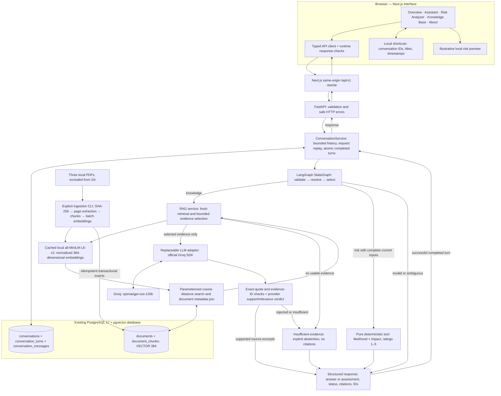
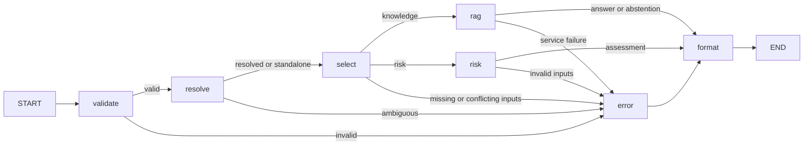

# CyberSage architecture

This diagram describes the implemented local application at Milestone 11,
not a proposed deployment. The final submission preserves that implementation.
See the [final report](CyberSage_Final_Assignment_Report.md) and
[integration evidence](milestone11-integration.md).

## System and data flow

The arrows between storage and services represent reads/writes, not graph
execution loops. The browser never calls Groq or PostgreSQL directly. Provider
credentials remain in the existing backend environment. Next.js supplies a
transport rewrite, not a second domain backend.

## Bounded agent transitions

This is one acyclic agent, with an eight-step recursion guard. There are no
autonomous shell/network tools, multi-agent loops or graph checkpointers.
Conversation persistence is implemented outside the graph in PostgreSQL.

## Trust boundaries

- User messages and PDF text are untrusted. PDFs are evidence, not executable
  instructions. Only selected passages within configured budgets reach Groq.
- Stable evidence IDs are assigned locally. Citation titles, filenames, physical
  PDF pages and chunk indices come from stored metadata, not model guesses.
- Exact quote provenance and valid IDs are necessary but do not prove factual
  entailment or complete coverage. Unsupported output can cause abstention.
- Recent user context resolves follow-ups before fresh retrieval. Prior assistant
  prose is not source evidence; risk numbers are not inherited from earlier turns.
- The backend is authoritative for confirmed risk results. The frontend's
  preview is separately labeled and cannot override the submitted result.
- Conversation IDs grant history access without authentication. The interface
  exposes no list-all-conversations endpoint. This is a local research system.

Implementation references: [agent graph](../backend/app/agent/service.py),
[RAG](../backend/app/rag/service.py), [memory](../backend/app/memory/service.py),
[retrieval](../backend/app/retrieval/service.py),
[API client](../frontend/src/lib/api.ts).
